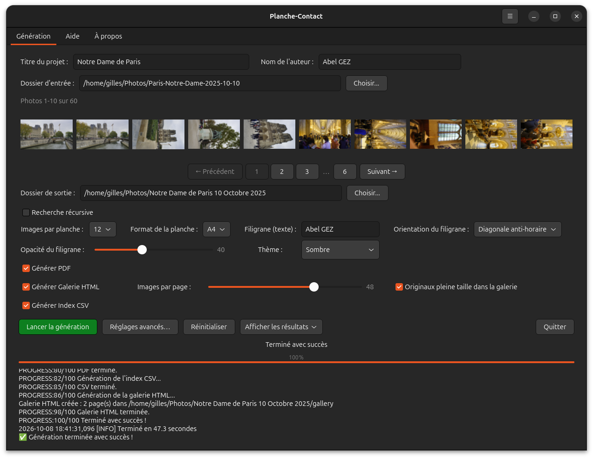
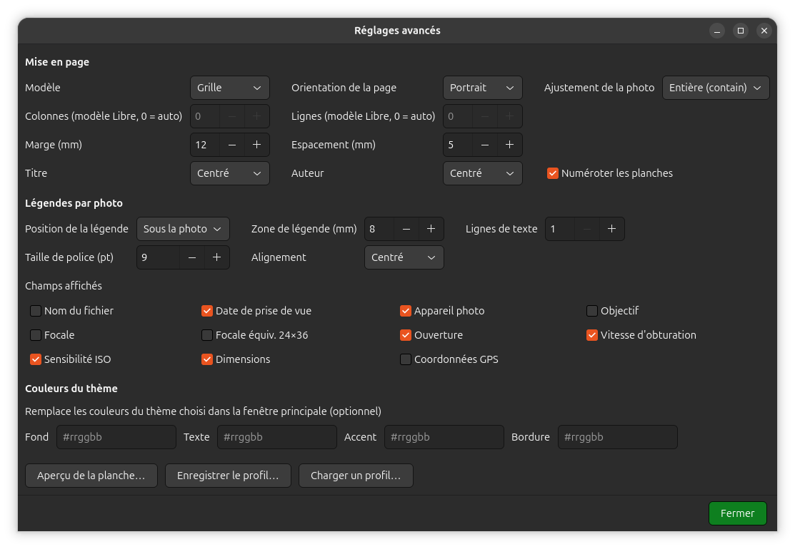
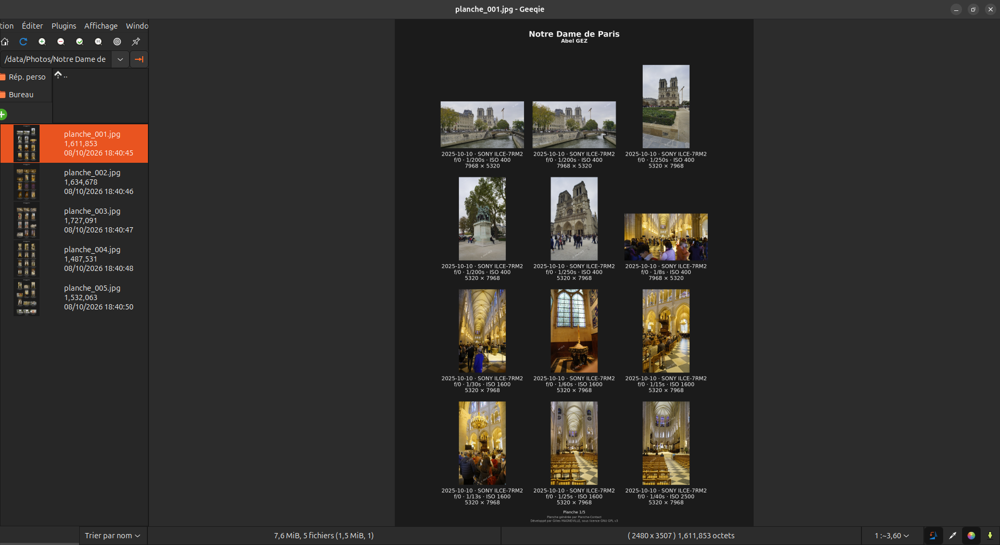
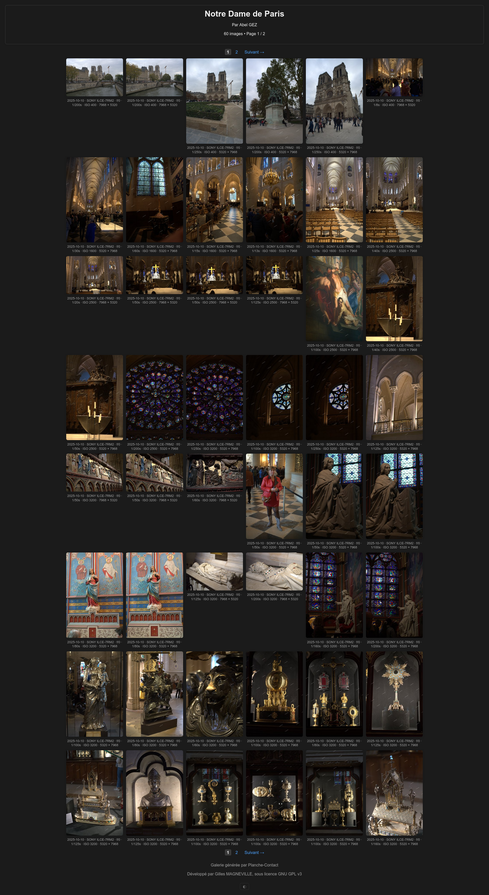
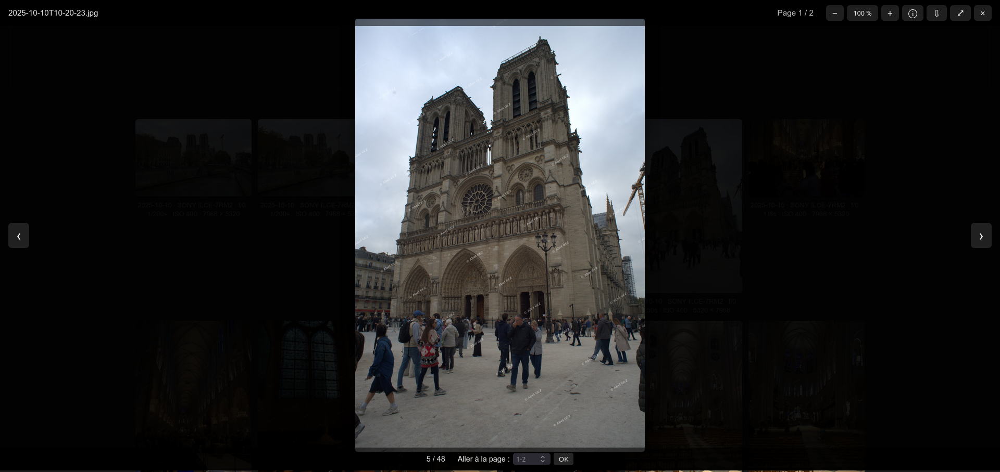
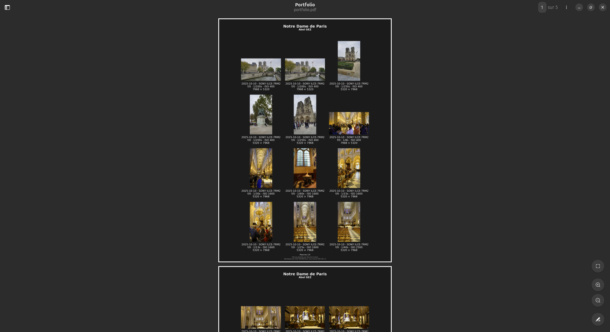

<p align="center">
  
</p>

<h1 align="center">Planche-Contact</h1>

<p align="center">
🇬🇧 <a href="README.md">English version</a>
</p>

<p align="center">
<strong>Des planches contact professionnelles à partir d'images JPEG et RAW</strong>
</p>

<p align="center">


</p>

<p align="center">


-0078D6)


</p>

<p align="center">

Créez des planches contact de qualité professionnelle directement à partir de dossiers d'images JPEG et RAW.

Générez des planches contact haute résolution, des documents PDF, des galeries HTML responsives et des index CSV — **sans base de données, sans catalogue et sans import d'images**.

</p>

---

## Téléchargement

**Dernière version stable : [v5.2.0](https://github.com/gillesmagneville/planche-contact/releases/tag/v5.2.0)**

Planche-Contact est disponible sous forme de paquets prêts à l'emploi pour Linux et Windows.

### Linux

**Debian / Ubuntu — 64 bits**

[Télécharger `planche-contact_5.2.0_amd64.deb`](https://github.com/gillesmagneville/planche-contact/releases/download/v5.2.0/planche-contact_5.2.0_amd64.deb)

```bash
sudo apt install ./planche-contact_5.2.0_amd64.deb
```

SHA-256 :

```text
aa63f26c6a00f5316ba8c793f1972ab5e1b36fa67935dcc1d5690a1a4a000e27
```

**Toutes distributions Linux — AppImage**

[Télécharger `Planche-Contact-5.2.0-x86_64.AppImage`](https://github.com/gillesmagneville/planche-contact/releases/download/v5.2.0/Planche-Contact-5.2.0-x86_64.AppImage)

```bash
chmod +x Planche-Contact-5.2.0-x86_64.AppImage
./Planche-Contact-5.2.0-x86_64.AppImage
```

SHA-256 :

```text
2929fcf5c732b2ab1154bc14ef686d8a8e334b057708f7767e3e32970e71ac8e
```

Un seul fichier qui embarque Python, GTK 4 et toutes les bibliothèques nécessaires à Planche-Contact : rien à installer. Détails et construction : [AppImage](#appimage-toutes-distributions-linux).

### Windows

**Windows 10 / 11 — Installeur**

[Télécharger `planche-contact_5.2.0_windows-setup.exe`](https://github.com/gillesmagneville/planche-contact/releases/download/v5.2.0/planche-contact_5.2.0_windows-setup.exe)

SHA-256 :

```text
3f6e056492b0d99a804437d3f92a97e068581e6b1837b426b7c7c262b74aea51
```

**Windows — Version portable**

[Télécharger `planche-contact_5.2.0_windows-portable.zip`](https://github.com/gillesmagneville/planche-contact/releases/download/v5.2.0/planche-contact_5.2.0_windows-portable.zip)

SHA-256 :

```text
737754f129431d4d047adc8151049070fe33b1c39474e7d4b6a2d471a866935e
```

Si vous voulez simplement utiliser Planche-Contact, **vous n'avez pas besoin de le compiler depuis les sources**.

---

## Qu'est-ce qui distingue Planche-Contact ?

Planche-Contact s'adresse aux photographes et aux collections d'images qui ont besoin d'un flux de travail simple, direct et professionnel, sans la complexité d'un système de gestion d'actifs numériques (DAM).

- **Pas de base de données**
- **Pas de catalogue**
- **Pas d'import d'images**
- Fonctionne directement à partir de vos dossiers d'images existants
- Prend en charge le **JPEG comme le RAW**
- Génère des planches contact professionnelles en **300 dpi**
- Crée des **documents PDF**
- Génère des **galeries HTML** responsives
- Fournit une **visionneuse d'images HTML** intégrée
- Permet le **téléchargement des images en pleine résolution**
- Affiche des informations **EXIF** personnalisables
- Prend en charge des **profils de présentation** réutilisables
- Offre un aperçu en direct avant la génération
- Inclut une interface **graphique et en ligne de commande**

---

## Fonctionnalités principales

### Planches contact professionnelles

Générez des planches contact de haute qualité à partir de dossiers d'images complets, avec des mises en page, des légendes, des thèmes et des options de présentation personnalisables.

Traitez toute une arborescence ou **choisissez les sous-dossiers à inclure**.

### Prise en charge du RAW

Traitez directement les fichiers RAW grâce à **LibRaw**, compatible avec les appareils de la plupart des grands fabricants.

### Légendes EXIF personnalisées

Affichez les métadonnées qui comptent pour vous (le nom du fichier s'affiche par défaut sous chaque photo), notamment :

- Nom de fichier
- Date
- Appareil
- Objectif
- Focale
- Ouverture
- Vitesse d'obturation
- ISO
- Dimensions de l'image
- Informations GPS

### Profils de présentation réutilisables

Enregistrez vos réglages favoris de mise en page, de légendes, de thème et de présentation sous forme de **profils JSON** réutilisables.

### Aperçu en direct

Prévisualisez la planche contact avant de générer les documents finaux.

### Export PDF

Générez des documents PDF haute résolution adaptés à l'impression, à l'archivage ou au partage.

Les légendes, titres et numéros de page sont aussi posés sur chaque page sous forme de texte invisible : les noms de fichiers peuvent être **sélectionnés, copiés et recherchés** dans n'importe quel lecteur PDF.

### Galeries HTML

Créez des galeries HTML responsives, consultables directement dans un navigateur web.

Les galeries générées incluent une visionneuse d'images intégrée dotée de fonctions telles que :

- Zoom
- Navigation entre les images
- Informations sur l'image
- Accès à l'image en pleine résolution
- Téléchargement de l'image

### Export CSV

Générez des index CSV contenant les informations des images, pour un traitement ultérieur ou un archivage.

### Interface en ligne de commande

Utilisez Planche-Contact depuis des scripts ou des flux de travail automatisés grâce à son interface en ligne de commande.

### Linux et Windows

La même application est disponible sous Linux et sous Windows.

---

<p align="center">

</p>

---

# Sommaire

- [Pourquoi Planche-Contact ?](#pourquoi-planche-contact-)
- [Comparaison des flux de travail](#comparaison-des-flux-de-travail)
- [Exemples de résultats](#exemples-de-résultats)
- [Formats RAW pris en charge](#formats-raw-pris-en-charge)
- [Installation](#installation)
- [Compilation depuis les sources](#compilation-depuis-les-sources)
- [Version Windows](#version-windows)
- [Documentation](#documentation)
- [Feuille de route](#feuille-de-route)
- [Contribuer](#contribuer)
- [Licence](#licence)

---

# Pourquoi Planche-Contact ?

Planche-Contact est conçu pour générer rapidement et simplement des planches contact photographiques professionnelles.

Contrairement aux applications de gestion d'actifs numériques (DAM), il n'exige ni import des images dans un catalogue ni maintenance d'une base de données. Il travaille directement à partir des dossiers existants et génère immédiatement des planches contact de haute qualité, des documents PDF, des galeries HTML responsives et des index CSV.

Idéal pour les photographes, les musées, les archives, les studios et les collections d'images.

---

# Comparaison des flux de travail

| Fonctionnalité | Planche-Contact | Flux de travail avec catalogue |
|:---------------|:---------------:|:------------------------------:|
| Base de données requise | ❌ | ✅ |
| Import des images | ❌ | ✅ |
| Gestion d'un catalogue | ❌ | ✅ |
| Traitement direct d'un dossier | ✅ | ⚠️ |
| Prise en charge du JPEG | ✅ | ✅ |
| Prise en charge du RAW | ✅ | ✅ |
| Planches contact 300 dpi | ✅ | ⚠️ |
| Export PDF | ✅ | ⚠️ |
| Galerie HTML responsive | ✅ | ⚠️ |
| Export d'un index CSV | ✅ | ❌ |
| Flux de travail léger | ✅ | ❌ |
| Libre et open source (GPL v3) | ✅ | variable |

---

# Exemples de résultats

<table>
<tr>

<td align="center" width="50%">

<b>Fenêtre principale</b><br><br>


</td>

<td align="center" width="50%">

<b>Paramètres avancés</b><br><br>



</td>

</tr>

<tr>

<td align="center" width="50%">

<b>Planche contact générée</b><br><br>



</td>

<td align="center" width="50%">

<b>Galerie HTML responsive</b><br><br>



</td>

</tr>

<tr>

<td align="center" width="50%">

<b>Visionneuse d'images HTML</b><br><br>



</td>

<td align="center" width="50%">

<b>PDF généré</b><br><br>



</td>

</tr>
</table>

---

## Pourquoi utiliser Planche-Contact ?

Un flux de travail type peut se résumer à ceci :

```text
Dossier d'images JPEG / RAW
        │
        ▼
  Planche-Contact
        │
        ├──► Planche contact
        │
        ├──► Document PDF
        │
        ├──► Galerie HTML
        │         │
        │         └──► Visionneuse d'images en pleine résolution
        │
        └──► Index CSV
```

Ni catalogue, ni base de données, ni import d'images ne sont nécessaires.

Planche-Contact est donc particulièrement utile lorsque vous voulez simplement **présenter, passer en revue, archiver ou partager un dossier d'images** sans mettre en place un flux de travail DAM complet.

---

# Nouveautés de la v5.2.0

La version **5.2.0** répond à des demandes d'utilisateurs.

Parmi les points forts :

- Le **nom du fichier** s'affiche par défaut sous chaque photo dans l'interface graphique
- **PDF à texte sélectionnable** : noms de fichiers, titre et numéros de page se sélectionnent, se copient et se recherchent
- **Choix des sous-dossiers** à inclure (interface graphique, options `--include-dir` et `--include-dirs-file`)
- **AppImage** : un seul fichier pour toutes les distributions Linux, avec son empreinte SHA-256
- Documentation bilingue (anglais / français) et quatre manuels embarqués dans les paquets

Consultez les [notes de version complètes de la v5.2.0](https://github.com/gillesmagneville/planche-contact/releases/tag/v5.2.0) pour la liste détaillée des changements.

---

# Formats RAW pris en charge

Planche-Contact prend en charge les fichiers RAW grâce à **LibRaw**, ce qui garantit la compatibilité avec les appareils de la plupart des grands fabricants.

| Canon | Nikon | Sony | Fujifilm |
|-------|--------|-------|-----------|
| Panasonic | Olympus / OM System | Pentax | Leica |
| Hasselblad | Sigma | Phase One | et bien d'autres... |

---

# Installation

Téléchargez le dernier paquet **.deb** depuis la page **Releases**.

```bash
sudo apt install ./planche-contact_<version>_amd64.deb
```

## AppImage (toutes distributions Linux)

Un seul fichier autonome qui embarque Python, GTK 4 et toutes les bibliothèques nécessaires à Planche-Contact, y compris la bibliothèque C : il ne dépend ni des paquets, ni de la version de la distribution qui l'exécute.

```bash
chmod +x Planche-Contact-<version>-x86_64.AppImage
./Planche-Contact-<version>-x86_64.AppImage
```

Vérifiez le fichier téléchargé avec le fichier `.sha256` publié à côté :

```bash
sha256sum -c Planche-Contact-<version>-x86_64.AppImage.sha256
```

Le même fichier donne accès à la ligne de commande :

```bash
./Planche-Contact-<version>-x86_64.AppImage portfolio -i ~/Photos -o ~/Planches --pdf
```

Si votre système ne sait pas monter les AppImage (pas de FUSE), laissez le fichier se décompresser lui-même le temps de l'exécution :

```bash
APPIMAGE_EXTRACT_AND_RUN=1 ./Planche-Contact-<version>-x86_64.AppImage
```

**Le construire vous-même** (Debian / Ubuntu) :

```bash
sudo apt install python3 python3-venv python3-gi gir1.2-gtk-4.0 patchelf binutils curl strace
cd planche-contact
./build-appimage.sh --test
```

Cela produit `Planche-Contact-<version>-<arch>.AppImage` et son `.sha256` à la racine du projet (`--test` lance ensuite une vraie génération de PDF et démarre l'interface sous un affichage virtuel ; ajoutez `xvfb` aux paquets ci-dessus pour cette dernière étape). Le script télécharge `quick-sharun` depuis le projet [Anylinux-AppImages](https://github.com/pkgforge-dev/Anylinux-AppImages) et **vérifie son empreinte SHA-256 avant de l'exécuter** : si le script amont a changé, la construction s'arrête au lieu d'exécuter un code que personne n'a relu.

- L'interface est dessinée par le rendu logiciel de GTK (Cairo) : ni OpenGL, ni Vulkan, ni pilote graphique n'est nécessaire, et les bibliothèques graphiques de la machine ne sont pas chargées.
- L'AppImage est construite pour l'architecture de la machine qui la construit (`x86_64`, `aarch64`...).
- État : construite sur Ubuntu 24.04 (x86_64), testée sous un affichage X virtuel et sur la machine du mainteneur. Les autres distributions et Wayland n'ont pas encore été testés — les retours sont les bienvenus.

---

# Compilation depuis les sources

Clonez le dépôt.

```bash
git clone https://github.com/gillesmagneville/planche-contact.git
```

Placez-vous dans le répertoire du projet.

```bash
cd planche-contact
```

Installez les dépendances requises.

Lancez l'application.

---

# Version Windows

Planche-Contact est disponible sous Windows 10/11 et partage exactement le
même moteur (`portfolio/`) et la même interface GTK4 (`planche-contact-gtk.py`)
que la version Linux — il n'y a pas de code source séparé à maintenir.

**État :** validé sur du matériel Windows réel, sans problème connu —
version officielle. Les scripts de construction produisent à la fois un
`.zip` portable et un installeur `.exe`.

```powershell
.\build-windows.ps1
```

Le script vérifie les prérequis (Python 64 bits, GTK4 via
[gvsbuild](https://github.com/wingtk/gvsbuild), PyInstaller, NSIS) et
propose d'installer automatiquement tout ce qui manque. Consultez
[`windows/README.fr.md`](windows/README.fr.md) pour le détail complet, les
prérequis et le dépannage.

> **Remarque :** l'installeur n'étant pas (encore) signé numériquement,
> Windows affichera très probablement un écran bleu **« Windows a protégé
> votre PC »** (SmartScreen) au premier lancement. C'est normal pour un
> petit projet open source non signé — ce n'est pas le signe d'un logiciel
> malveillant. Cliquez sur **Informations complémentaires**, puis sur
> **Exécuter quand même** pour continuer. L'avertissement s'estompe avec
> le temps, à mesure que l'installeur gagne en réputation auprès de
> SmartScreen, ou disparaît immédiatement avec un certificat de signature
> de code payant (voir la feuille de route).

---

# Documentation

| Fichier | Description |
|---------|-------------|
| [README.fr.md](README.fr.md) · [🇬🇧](README.md) | Présentation du projet |
| Manuel — [Français](docs/planche-contact-manual.html) · [English](docs/planche-contact-manual.en.html) · [Deutsch](docs/planche-contact-manual.de.html) · [Español](docs/planche-contact-manual.es.html) | Manuel d'utilisation complet (également ouvert par l'onglet « Aide » de l'application) |
| [windows/README.fr.md](windows/README.fr.md) · [🇬🇧](windows/README.md) | Instructions de construction sous Windows, prérequis, dépannage |
| [CHANGELOG.fr.md](CHANGELOG.fr.md) · [🇬🇧](CHANGELOG.md) | Historique des versions |
| [CONTRIBUTING.fr.md](CONTRIBUTING.fr.md) · [🇬🇧](CONTRIBUTING.md) | Guide de contribution |
| [PROJECT_CONTEXT.fr.md](PROJECT_CONTEXT.fr.md) · [🇬🇧](PROJECT_CONTEXT.md) | Notes pour les développeurs : architecture, conventions, décisions techniques |
| CODE_OF_CONDUCT.md | Règles de la communauté |
| LICENSE | GNU GPL v3 |

---

# Feuille de route

- ~~Internationalisation (i18n)~~ — **fait** : interface graphique, ligne de commande, galerie HTML générée et manuel d'utilisation (anglais, français, allemand, espagnol).
- ~~Modèles de planches contact personnalisés~~ — **fait** : légendes EXIF personnalisables (nom de fichier, date, appareil, objectif, focale, ouverture, vitesse d'obturation, ISO, dimensions, GPS), modèles de mise en page (grille, paysage, portrait, grandes vignettes, libre), thèmes clair/sombre/neutre/système avec couleurs personnalisées en option, et aperçu en direct avant la génération — le tout partagé entre les planches contact JPEG/PDF et la galerie HTML, et enregistrable sous forme de profils JSON réutilisables. Voir le [manuel d'utilisation](docs/planche-contact-manual.html) ou la section « Avancé » de l'application pour le détail.
- Formats d'export supplémentaires
- Personnalisation du PDF améliorée

---

# Contribuer

Les contributions sont les bienvenues.

Que vous souhaitiez signaler un bug, suggérer une fonctionnalité, améliorer la documentation ou proposer du code, votre aide est appréciée.

Merci de lire **CONTRIBUTING.fr.md** avant d'ouvrir une Issue ou une Pull Request.

---

# Licence

Planche-Contact est développé par **Gilles MAGNEVILLE**, avec l'aide de
[Claude.ai](https://claude.ai) (Anthropic).

Distribué selon les termes de la **GNU General Public License v3.0**.

---

<p align="center">

⭐ <strong>Si Planche-Contact vous est utile, pensez à donner une étoile au projet.</strong>

</p>
